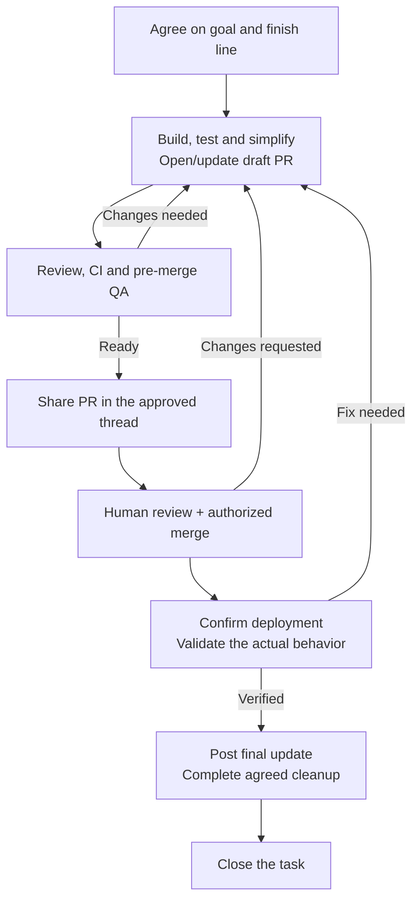

# Development Workflow

Carry the whole agreed outcome to its finish line, normally in the same task.
An artifact, specialist result, completed plan, or task record is not that finish
line. Scope changes come from the user's agreement, not from a phase transition.

Ownership is responsibility, not execution permission or delivery proof. With
v2 tools, `task_block` pauses actual work without releasing ownership;
`task_resume` starts useful approved work on an owned Ready/Blocked task.
Repeating `task_claim` on that owned task does **not** resume it. Done/Deferred
need reopening before execution. Use `task_release` for an intentional handoff
or switch after safe resource cleanup, then claim the next task. Follow the
[version-specific handoff recipe](references/handoff-and-communication.md):
legacy v1 tools retain their different wait/claim behavior. Do not activate a
new writer merely to obtain a missing tool.

## Navigate the delivery loop

For new tracked work with an active area/project catalog, **read
[Project selection](references/project-selection.md) before forming the placement
and approval proposal**.
Reuse an existing task when it already covers the goal; routine operations on
that task do not need another placement decision.

Under **Intent → Design → Build and Test → Deploy**, full delivery follows this
map. Arrows grant no authority. An agreed RFC-only or PR-only mission can finish
earlier; include only phases and communication within the agreed scope.

At pickup, resume, or a material transition, compare the latest user agreement
with the task description, evidence, and current facts. The description keeps the
mission, observable finish criteria, and scope. Revalidate the recorded
`next_step`; it is one current action/check, not a plan, permission, or proof of
completion. Missing or contradictory records require conversation-based judgment,
not a smaller inferred mission. When refreshing records, carry only agreed
outcomes and audiences; available tools, IDs and destinations are context, not
authorization.

| Choice    | Condition                                                                                                      |
| --------- | -------------------------------------------------------------------------------------------------------------- |
| **Act**   | Useful already-authorized work remains. Take the next action without asking whether to continue.               |
| **Ask**   | A missing scope, risk, authority, or outcome decision changes the next action. Ask that question.              |
| **Wait**  | Only a concrete external prerequisite remains. Preserve the next action and release temporary resources.       |
| **Close** | The agreed finish line is met and remaining commitments are fulfilled or explicitly dispositioned by the user. |

Load the reference for the current boundary:

- [Delivery](references/delivery.md): bounded simplification, draft PRs,
  correctness-first and explicit structural review, CI/QA, fixes, ready-PR sharing
  and authorized merge.
- [Verification](references/verification.md): candidate-bound proof,
  post-deployment behavior, gaps and exceptions.
- [Handoff and communication](references/handoff-and-communication.md):
  `task_update(... next_step ...)`, same-task waiting, communication and cleanup.

Use repository-appropriate skills and tools; their defaults do not expand
permission. Respect explicit stops, denials, retry limits and native async waiting.
Use `explaining-technical-work` for substantial explanations, not routine status.
